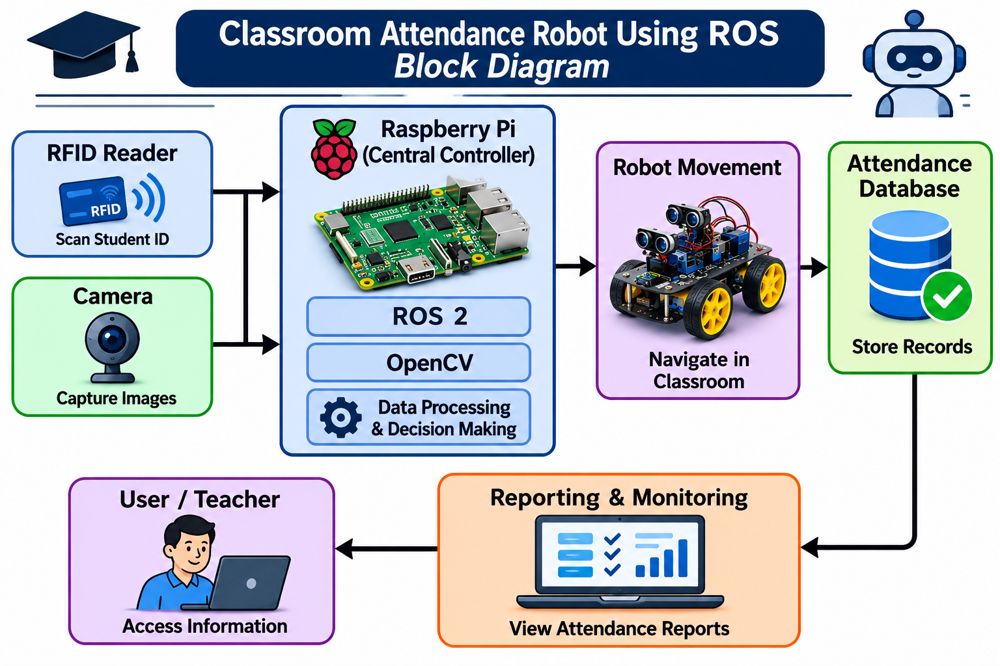

# Classroom Attendance Robot Using ROS

### Automating Attendance Tracking Through Robotic Systems and ROS 2 Framework

---

## 📖 Project Overview

The Classroom Attendance Robot is an automated attendance tracking system designed to reduce manual attendance errors and improve classroom attendance management.

The project uses robotic systems and the ROS 2 framework, integrating Raspberry Pi, RFID modules, cameras, motors, Gazebo simulation, and OpenCV for automated attendance tracking and reporting.

## 🎯 Objectives

- Automate classroom attendance tracking.
- Reduce manual attendance errors.
- Improve attendance recording accuracy.
- Enable real-time attendance monitoring.
- Generate attendance reports automatically.
- Develop a scalable attendance management system.

## ⚠️ Problem Statement

Manual attendance systems face several challenges:

- Misrecording student names.
- Forgetting to mark attendance.
- Confusion between absences and late arrivals.
- Inaccurate attendance reports.
- Time-consuming attendance management.

The proposed robotic system aims to address these challenges through automation.

## 🔧 Hardware Components

| Component | Function |
|---|---|
| Raspberry Pi | Central control unit |
| RFID Modules | Object identification and tracking |
| Camera | Visual input and monitoring |
| Motors | Robot movement and control |

## 💻 Software and Technologies

| Technology | Application |
|---|---|
| ROS 2 | Robotic system management |
| Gazebo | Robot navigation simulation |
| OpenCV | Image processing and object recognition |
| Raspberry Pi OS | Hardware control environment |
## 📁 Repository Files

| File | Description |
| :--- | :--- |
| [Classroom Attendance Robot Using ROS.pptx](Classroom%20Attendance%20Robot%20Using%20ROS.pptx) | Project presentation covering system overview, architecture, hardware/software stack, and evaluation targets |
| [classroom_attendance.py](classroom_attendance.py) | Python script handling classroom attendance logic and data processing |
| [classroom_attendance.wbt](classroom_attendance.wbt) | Simulation world file for testing the classroom attendance environment |
| [student_roster.csv](student_roster.csv) | Input student roster dataset used for matching and attendance tracking |
| [attendance_log.csv](attendance_log.csv) | Attendance log recording tracked student attendance entries |
| [Classroom-Attendance-Robot-Block-Diagram.png](Classroom-Attendance-Robot-Block-Diagram.png) | System block diagram illustrating hardware and software components |
## ⚙️ System Flow and Operation

### 1. Attendance Scanning
Capture attendance data through scanners for real-time tracking.

### 2. Data Processing
Automatically analyze attendance information and manage records.

### 3. Reporting
Generate attendance summaries for monitoring and management.

## 🏗️ System Architecture

The proposed system integrates:

- Raspberry Pi as the central controller.
- RFID modules for identification and tracking.
- Camera for visual input.
- Motor systems for robot movement.
- ROS 2 for robotic system integration.
- OpenCV for image processing.
- Gazebo for simulation and testing.

## ✅ Advantages

- Improved data accuracy.
- Streamlined attendance tracking.
- Reduced manual work.
- Scalable for larger user groups.
- Automated attendance reporting.

## ⚠️ Challenges

- Initial setup costs.
- Maintenance requirements.
- Need for technical expertise.
- Data protection and security.

## 💰 Cost Analysis and Budgeting

The project considers:

1. Component-wise price estimation.
2. Potential funding sources.
3. Cost reduction through system optimization.

## 🚀 Future Enhancements

- Artificial Intelligence integration.
- Additional robotic functionalities.
- Improved decision-making capabilities.
- Expansion to multiple educational platforms.
- Enhanced attendance monitoring and reporting.

## 📊 Project Evaluation Targets

| Parameter | Target |
|---|---:|
| Attendance accuracy | 100% |
| Time savings | 50% |
| Cost reduction | 25% |

*These are targets presented in the project presentation, not independently verified experimental results.*

## 🔐 Security and Data Protection

The presentation identifies the importance of:

- Data encryption.
- Secure databases.
- Access control mechanisms.

## 🎓 Conclusion

The Classroom Attendance Robot using ROS 2 proposes an automated solution for classroom attendance management. By integrating robotic systems, RFID, Raspberry Pi, and computer vision, the project aims to reduce manual errors, improve efficiency, and support scalable attendance tracking.

---

## 🛠️ Tools and Technologies

`ROS 2` `Python` `Raspberry Pi` `RFID` `OpenCV` `Gazebo` `Robotics`

## 👨‍🎓 Project Category

Robotics | Automation | Computer Vision | Embedded Systems
